# Group 28 实验手册与结果

本项目用同一份微博样本，按文字和发帖行为给已发生的话题分组，并给次日可能变热的话题排序。HMI 是 Human-Manipulation Index，本项目用它汇总四项发帖行为的相对排名，定义见第 4 节。

原方案的正式预测在 35 天中每天推荐 5 个话题，完整随机森林命中 84 次，仅用活跃度的随机森林命中 44 次。补充实验见第 10 节。图可用 PNG（图像文件）预览，也可打开配套的 PDF（便携式文档，本报告中的图可矢量缩放）。

| 要回答的问题 | 查看本文件的章节 |
| --- | --- |
| 用了哪些微博，程序如何读取 | [1. 数据和分析单位](#1-数据和分析单位) |
| 文字怎样变成数字，怎样比较不同分组方案 | [2. 文字与行为特征](#2-文字与行为特征)、[3. 聚类与稳定性](#3-聚类与稳定性) |
| HMI、MisBot 风格分数、标签共同出现、时段模式与热点案例各有什么结果 | [4. HMI 特征对照](#4-hmi-特征对照)至[7. 热点案例与根帖检查](#7-热点案例与根帖检查) |
| 哪个模型预测得更好 | [8. 次日热点预测](#8-次日热点预测) |
| 怎样运行，去哪里找图和表 | [9. 重跑命令与产物位置](#9-重跑命令与产物位置) |
| 改变实验条件后，结果是否仍成立 | [10. 补充实验](#10-补充实验) |

## 1. 数据和分析单位

实验使用 **Weibo-COV 2.0**（新冠疫情微博数据集）2020 年 9 月 1 日至 11 月 30 日的样本。原始三张月表有 8,149,927 条记录。按帖子编号的固定哈希规则抽取约 1/32，得到 **254,624 帖、199,851 位用户**。本地 CSV（逗号分隔表格）为 `data/processed/weibo.csv`，JSON（结构化文本）说明文件为 `data/weibo_manifest.json`。程序用 SHA-256（生成 256 位文件指纹的算法）核对数据版本，然后删去必填项为空或时间无法解析的记录，并按帖子编号去重。本文以北京时间计日。 [数据交接](docs/reviews/weibo_cov_handoff.md) · [加载代码](src/experiment_io.py)

| 字段 | 在实验中的作用 |
| --- | --- |
| `mid` | 帖子编号，用于去重和查找根帖。 |
| `content` | 微博正文。程序提取由一对井号 `#` 标出的标签，计算文字相似度和重复程度，并识别转发标记。 |
| `user_id` | 用户编号，用于统计不同作者数、计算少数作者集中发帖的程度。 |
| `created_at` | 发帖时间，用于按日、小时或分钟统计活动。 |
| `origin_weibo` | 原帖引用，只用于统计有多少引用能在这个样本中找到对应根帖。 |
| 点赞、评论和转发计数 | 原表保留这些计数，本次聚类和预测不把它们作为输入。 |

描述性分析的一行可以代表一个**话题**，也可以代表一个**话题日**，即某个标签在某天的活动。程序排除「疫情」「新冠」等九个用于采集语料的宽泛标签，保留全期至少 **30 帖、5 位作者**的话题。得到 **1,422 个话题**，涉及 **117,255 条不同微博**。一帖可以带多个标签，因此一共记录到 **211,370 次帖子与话题的对应关系**。预测使用自己按日期计算的候选门槛，见第 8 节。 [话题筛选与特征](src/mining_experiment.py#L21) · [筛选记录](results/experiments/topic_design.json)

## 2. 文字与行为特征

### 2.1 把文字变成一列列数字

1. **为每个话题做一份文档。** 汇总带该标签的微博正文，删掉正文里的 `#标签#`。这样，共同的标签名本身不会直接决定两份文档有多相似。
2. **把文字拆成相邻字符片段。** 实际代码取连续的两个或三个字符。用虚构短句「公交恢复」举例，两个字符的片段有「公交」「交恢」「恢复」，三个字符的片段有「公交恢」「交恢复」。同一个片段在所有话题的数值表中对应同一列。
3. **给片段加权。** TF–IDF 是词频与逆文档频率的乘积，用来提高本话题常见、其他话题相对少见的字符片段的权重。代码按对数缩小频繁重复的影响，过滤出现在少于 3 个话题或多于 90% 话题的片段，最多保留 16,000 列。每个话题由一行数字表示，未出现的片段对应 0。
4. **把长向量压成 16 个数字。** 截断 SVD（奇异值分解）用 16 个方向概括原数值表的变化。这些方向保留了约 **25.13%** 的原数值变化。程序最后把每行缩放到相同长度。 [文字向量实现](src/mining_experiment.py#L56)

### 2.2 把发帖行为变成一列列数字

| 数值项 | 怎么算 |
| --- | --- |
| 文本重复比例 | 先去掉网址、提及用户名和空白，并统一大小写。用 1 减去不同文本数占总帖数的比例。5 帖只有 3 种文本时，重复比例是 40%。 |
| 作者集中程度（HHI，赫芬达尔—赫希曼指数） | 对每位作者的发帖份额平方后求和。发帖份额为 60%、30%、10% 时，HHI 等于 0.46。数值越大，发帖越集中。 |
| 峰值日占比 | 发帖最多那一天的帖子量除以该话题全期帖子量。 |
| 同分钟发帖占比 | 找到同一话题至少有两帖落入的每个自然分钟，把这些分钟内的帖子数加起来，再除以该话题总帖数。 |
| 夜间占比、转发标记占比、时段分散程度 | 统计 00:00–05:59 的帖子份额、带正文转发标记的帖子份额及 24 小时发帖分布的均匀程度。 |
| 小时分布与话题生命周期 | 24 个数表示一天各小时的发帖份额，另 10 个数表示从该话题首帖到末帖的等长十段各有多少发帖份额。 |

这七个摘要数值加上两组分布共 **41 维**。程序逐列减去平均值并除以标准差，让量纲不同的列可以放在一起比较，再把每行调整到相同长度。**融合表示**将标准化的 41 维行为表示和 16 维文字表示等权拼接，得到 **57 维**。下文用这套数值比较谁与谁更相似。 [行为和融合实现](src/mining_experiment.py#L31)

## 3. 聚类与稳定性

**聚类**按相似性给话题分组。KMeans（K 均值）交替把话题分到最近的中心并重算中心，`k` 表示组数。Ward 从每个话题单独一组开始，每一步合并对组内差异增加最少的两组。文字、行为、融合三套输入都比较 3 至 8 组。KMeans 每个组数比较五个随机种子，每个种子尝试 20 种初始中心。Ward 在同一输入上运行一次。表里的加号「+」表示搭配。 [分组过程](src/mining_experiment.py#L74)

**Silhouette（轮廓系数）**比较一个话题到本组和到最近其他组的平均距离。接近 1 表示本组内更紧密、与其他组更分开，接近 0 表示靠近组间边界，负值表示到其他组的平均距离可能更小。下表每个分数都在**同一批 1,422 个话题、同一套 57 维融合特征**上计算。KMeans 的每项分数取五个随机种子的平均值。

| 输入与算法 | k=3 | k=4 | k=5 | k=6 | k=7 | k=8 |
| --- | ---: | ---: | ---: | ---: | ---: | ---: |
| 文字 + KMeans | 0.1382 | 0.1362 | 0.1339 | 0.1400 | 0.1450 | 0.1443 |
| 文字 + Ward | 0.1349 | 0.1258 | 0.1284 | 0.1362 | 0.1392 | 0.1408 |
| 行为 + KMeans | 0.1452 | 0.1505 | 0.1515 | 0.1466 | 0.1452 | 0.1441 |
| 行为 + Ward | 0.1329 | 0.1302 | 0.1363 | 0.1367 | 0.1248 | 0.1207 |
| 融合 + KMeans | 0.1466 | 0.1524 | 0.1526 | 0.1525 | **0.1564** | 0.1547 |
| 融合 + Ward | 0.1334 | 0.1290 | 0.1328 | 0.1285 | 0.1306 | 0.1287 |

原方案先限定融合输入、随机种子 28 和每组至少 10 个话题，再选轮廓系数最高的方案，选中 **融合 + KMeans，7 组**。它也取得上表最高分 **0.1564**，总体分离程度有限。 [聚类明细](results/experiments/clustering_grid.csv) · [选择记录](results/experiments/selected_clustering.json)

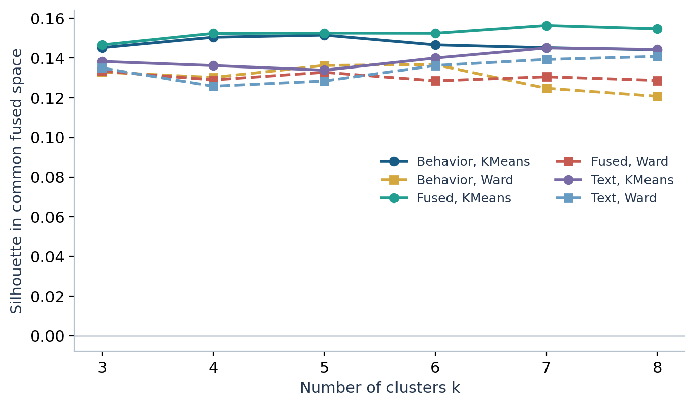

**图 03　融合特征搭配 KMeans 在 7 组时的轮廓系数最高，约为 0.156。** 横轴是组数，纵轴是共同融合空间的轮廓系数。实线圆点表示 KMeans，虚线方点表示 Ward。 [矢量图（PDF）](figures/experiments/03_method_comparison.pdf)

**t-SNE（t 分布随机邻域嵌入）**把 57 维融合特征映射到平面，尽量让原来相近的话题在图上也相近。图 02 和图 21 共用一次拟合得到的坐标（随机种子 28，局部邻域大小参数设为 30）。每点是一个话题，颜色是组别，组号按与原方案重叠最多的方式对齐。图上的局部颜色变化可用于观察分法，轮廓系数仍在 57 维融合特征上计算。

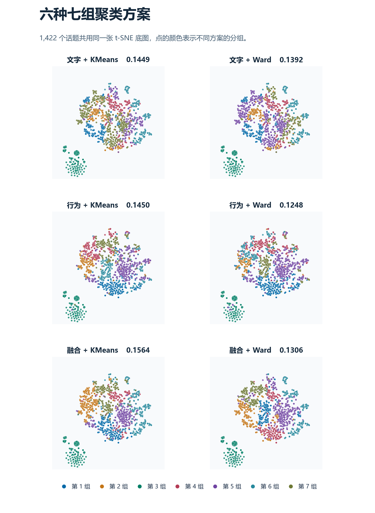

**图 02　六种分组在左下角多呈绿色，中央点群的分法各有不同。** 例如在融合特征下，中央点群的下缘在 KMeans 中以蓝色为主，在 Ward 中以红色为主。每个小图标题末尾是该次分组的轮廓系数，KMeans 图使用种子 28。

**第 3 组以共用同一批微博的标签为主。** 以左下的「融合 + KMeans」为准，绿色的第 3 组有 **155 个话题**，代表标签包括「大郴州[超话]」「资兴」「东江湖旅游」，也有「开学时间」「国庆节放假通知」「战疫打卡行动」等不同主题。按原始 57 维特征计算，该组话题的平均轮廓系数为 **0.797**，其余六组的话题合计平均为 **0.078**。

**异常识别：共用帖子解释了这批点为什么聚在一起。** 有 35 个标签出现在完全相同的 103 条微博中，另外 35 个标签出现在其中的 102 条微博中。这 103 条微博来自 5 位作者，按本实验的提取规则，一帖识别出的标签数中位数为 135。共用帖子让不同标签拥有相同或相近的文字、作者分布和发帖时间特征。

**话题门槛**指在整个观察期内，至少有多少条微博带有同一个标签，该标签才进入聚类。这里的原分组覆盖满足至少 **30 帖、5 位不同作者**条件的全部 1,422 个话题。将帖子门槛提高到 40、50、75 时，仍要求至少 5 位作者。每档复用原有融合特征，对该档保留的话题重做七组 KMeans，再在该档的话题上计算轮廓系数。

| 最低帖数 | 参与聚类的话题数 | 轮廓系数 |
| ---: | ---: | ---: |
| 30 | 1,422 | 0.1564 |
| 40 | 1,073 | 0.1820 |
| 50 | 892 | 0.2005 |
| 75 | 604 | **0.2372** |

门槛越高，本次保留话题的轮廓系数越高，覆盖的话题越少。各档使用的话题集合不同，分数描述各档保留话题的分离程度。

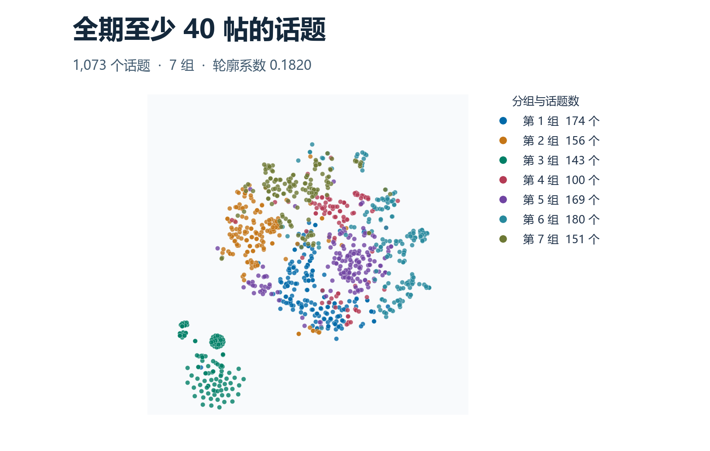

**图 21a　至少 40 帖时保留 1,073 个话题，轮廓系数为 0.1820。**

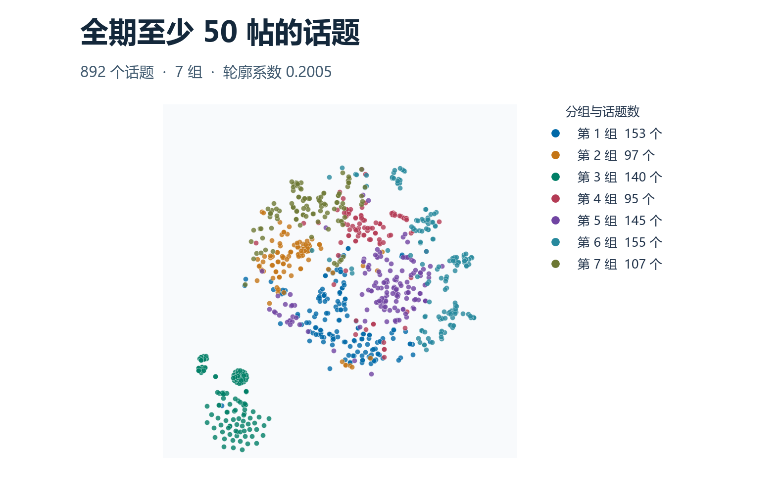

**图 21b　至少 50 帖时保留 892 个话题，轮廓系数为 0.2005。**

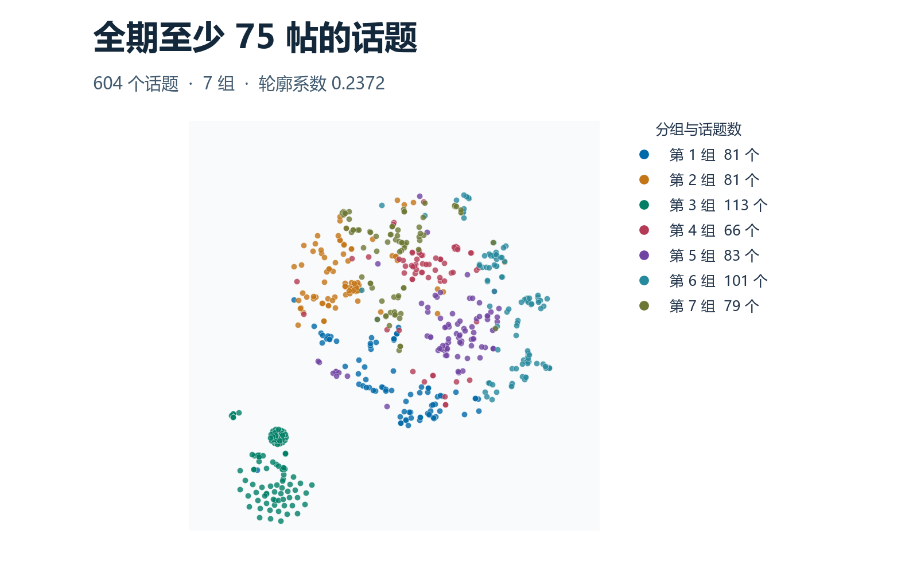

**图 21c　至少 75 帖时保留 604 个话题，轮廓系数为 0.2372。**

固定为七组后，每种方法抽取 80% 的话题重新分组，共重跑 20 次。用 ARI（调整 Rand 指数）比较每次重跑的结果与该方法在全部 1,422 个话题上对同一批话题的分组。数值越接近 1，两次分组越一致。

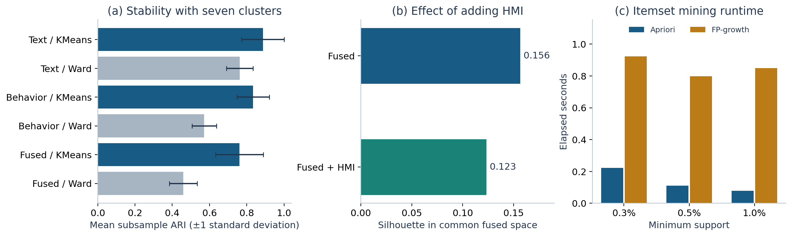

**图 15　固定 7 组时，文本 KMeans 的重跑稳定性最高。** 左图条长为平均 ARI，黑线向两侧各延伸一个标准差。中图显示，在同一融合空间中，加 HMI 后的轮廓系数从 0.156 降到 0.123。右图显示 Apriori 在本次三个支持度门槛下均更快，横轴是支持度门槛，纵轴是耗时秒数。 [稳定性表](results/experiments/cluster_stability_comparison.csv) · [HMI 对照表](results/experiments/hmi_only_ablation.csv) · [算法耗时表](results/experiments/pattern_method_comparison.csv) · [PDF](figures/experiments/15_descriptive_comparisons.pdf)

## 4. HMI 特征对照

**HMI** 在这里是一个相对行为分数。程序对每个话题的文本重复、作者集中、峰值日占比、同分钟发帖比例分别按大小排名。它先把数值舍入到 12 位小数，数值相同的排名取平均，再把名次转为百分位。四个百分位的平均就是 HMI。例如四项排名为 0.80、0.60、0.40、0.20，得到 HMI 0.50。它用来描述样本内这几种行为的强弱。 [HMI 实现](src/mining_experiment.py#L53)

**交接核验。** MisBot 是用于训练辅助风格模型的账号标注数据集。私有压缩包包含逐帖分数、话题汇总和回执。两张表的 SHA-256 和回执一致，回执中的微博数据指纹和本地样本一致。程序按帖子编号对齐全部 **254,624 帖**，再按第 1 节的话题门槛复算 **1,422 个话题**的发帖数、作者数和两种汇总分数。回执把 MisBot 训练输入标为 `official`（官方），组员的来源审计确认，官方训练文件与最初的镜像逐字节相同。本地压缩包的回执和两张分数表的校验值均与仓库公布的回执一致。 [交接复算记录](results/experiments/misbot_handoff_validation.json) · [来源审计](docs/reviews/misbot_audit.md) · [已发布回执](results/misbot_weibo_style_receipt.json)

**分数与对照。** 交接模型为每帖提供一个 0 到 1 的文本风格分数。按帖等权直接对话题内所有帖求平均。用户等权先对每位作者在该话题中的帖子求平均，再平均所有作者的分数，使发 1 帖和发 10 帖的作者各占一份权重。微博样本缺少目标域的人工真值，分数在这里用作描述文本风格的辅助特征。

**消融**指固定话题、KMeans 算法、7 组和随机设置，比较添加不同特征后的分组。57 维融合基线已包含 HMI 的四项原始行为指标。每项新分数先在全部话题上减去均值、除以标准差，再乘表中的权重。联合加入时，两项各再除以 2 的平方根，使同一权重可以用于一项或两项。每个对照用相同的 20 组 80% 话题子样本重跑。

| 对照 | 共同融合空间 silhouette | 与融合基线的 ARI | 80% 子样本重跑的平均 ARI |
| --- | ---: | ---: | ---: |
| 融合基线 | 0.1564 | 1.0000 | 0.7609 |
| 融合 + HMI（0.50） | 0.1232 | 0.3953 | 0.7375 |
| 融合 + 用户等权风格分数（0.50） | 0.1413 | 0.6005 | 0.7126 |
| 融合 + HMI + 用户等权风格分数（0.25） | 0.1540 | 0.8274 | 0.8271 |
| 融合 + HMI + 用户等权风格分数（0.50） | 0.1444 | 0.6251 | 0.7808 |
| 融合 + HMI + 用户等权风格分数（1.00） | 0.0928 | 0.2535 | 0.8629 |
| 融合 + 按帖等权风格分数（0.50） | 0.1412 | 0.5410 | 0.6843 |

单独加入风格分数后，用户等权比按帖等权的平均稳定性高（0.7126 和 0.6843），两者都低于融合基线（0.7609）。联合权重 0.25 时，分离度接近基线，平均稳定性升至 0.8271。联合权重 1.00 时，平均稳定性最高，分离度降幅最大，与基线的分组一致性也最低。 [消融明细](results/experiments/cib_informed_ablation.csv) · [联合权重 0.50 的七组画像](results/experiments/joint_cluster_profiles.csv)

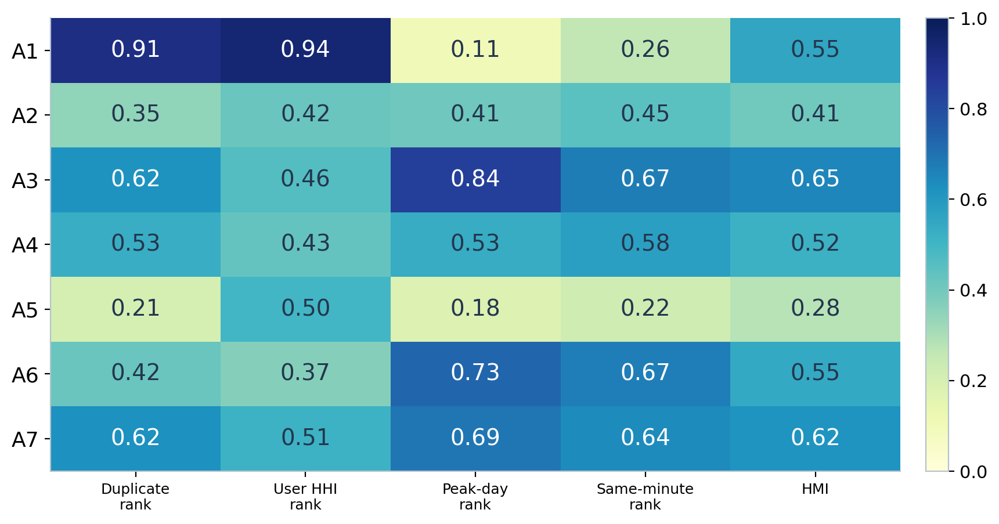

**图 12　加入 HMI 后，第 1 组（A1）的文本重复和作者集中平均百分位分别为 0.91 和 0.94，峰值日平均百分位仅为 0.11。** 每行是一组话题，前四列是四项行为百分位的组内均值，最后一列是平均 HMI。颜色越深，数值越高。 第 3 组（A3）的平均 HMI 最高，约为 0.65，表示其四项行为的平均相对排名较高。图 02 的第 3 组（C3）在加入 HMI 后都进入了本图的 A1，A1 的平均 HMI 约为 0.55。 [组间对应表](results/experiments/cluster_hmi_overlap.csv) · [组内均值](results/experiments/cib_informed_cluster_summary.csv) · [矢量图（PDF）](figures/experiments/12_cib_informed_profiles.pdf)

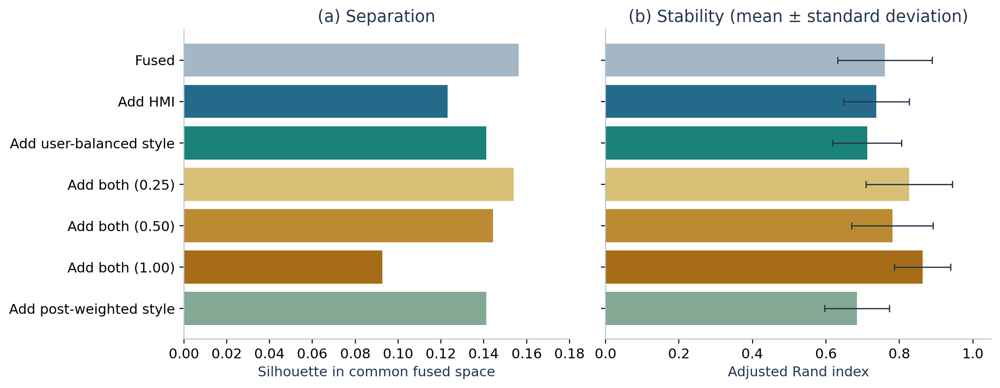

**图 19　融合基线的分离度最高。联合加入 HMI 和用户等权风格分数时，权重 0.25 最接近基线分离度，权重 1.00 的平均稳定性最高。** 每行对应表中一个对照。左图横轴是共同融合坐标中的轮廓系数，右图横轴是抽样重跑的 ARI 均值。右侧横线两端是均值加、减一个标准差，表示 20 次重跑的分数波动。 [PDF](figures/experiments/19_misbot_style_ablation.pdf)

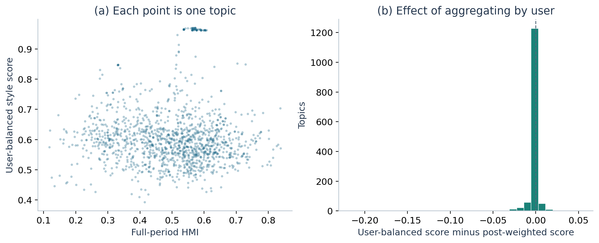

**图 20　风格分数与 HMI 的排名相关很弱（−0.035）。两种汇总方式的话题排名相关为 0.996，单个话题的最大分差为 0.217。** 左图横轴是全期 HMI，纵轴是用户等权风格分数，每个点代表一个话题。排名相关用 Spearman 相关系数衡量，范围从 −1 到 1，接近 0 表示缺少同升或同降的趋势。右图横轴是用户等权分数减去按帖等权分数，纵轴是话题数，虚线表示差值为 0。 [矢量图（PDF）](figures/experiments/20_misbot_style_diagnostics.pdf)

### 使用风格变化检查高频作者的影响

在 1,422 个话题中，按图 20 两种风格分数的**绝对差值**划分两组。小分差组小于 0.001，有 1,031 个话题。大分差组取分差最高的约 10%，有 143 个话题，门槛约为 0.00636。每个话题内按作者发帖量从高到低排序，同帖数时按作者编号排序。分别移除前 1 位、前 5 位作者的所有帖子，只用剩余帖子重算按帖平均分。原来的用户等权分数作为固定参照，用于判断分差是否缩小。 [独立复跑入口](src/misbot_author_influence.py)

| 分差组 | 移除作者 | 这些作者原发帖占比中位数 | 移除后可重算的话题数 | 按帖平均分的绝对变化中位数 |
| --- | --- | ---: | ---: | ---: |
| 小分差 | 前 1 位 | 2.3% | 1,031 | 0.0010 |
| 小分差 | 前 5 位 | 10.9% | 900 | 0.0021 |
| 大分差 | 前 1 位 | 10.0% | 143 | 0.0106 |
| 大分差 | 前 5 位 | 26.7% | 143 | 0.0236 |

占比用各组全部话题计算。小分差组有 131 个话题在去掉前 5 位作者后没有剩余帖子，因此变化量只统计可重算的 900 个话题。

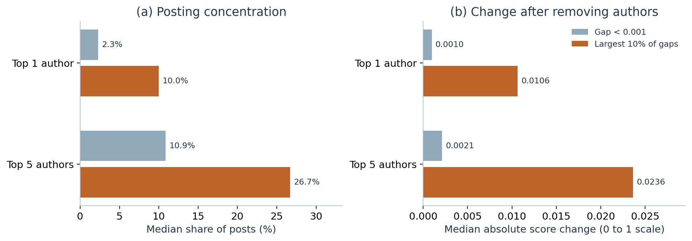

**图 22　大分差话题的帖子更集中于高频作者，移除这些作者后，按帖风格分的变化也更大。** 左图横轴是被移除作者发帖占比的中位数，右图横轴是重算前后的绝对变化中位数，分数范围为 0 到 1。两图纵轴都表示移除人数，灰蓝色为小分差组，橙色为大分差组。 [汇总结果](results/experiments/author_influence_summary.csv) · [矢量图（PDF）](figures/experiments/22_misbot_author_influence.pdf)

大分差组中，移除首位作者后，**131/143（91.6%）** 的话题更接近原来的用户等权分数。移除前 5 位后，**122/143（85.3%）** 更接近，其中 **70/143（49.0%）** 的分差至少减半。这说明高频作者对多数大分差话题的按帖平均分有明显影响，移除更多作者后的效果因话题而异。

#### 分差最大的 10 个话题

按分差的绝对值从大到小排名。表中的分差保留正负号，等于用户等权分减去按帖等权分。这 10 个话题的分差均为负，说明原来的按帖等权分都更高。

| 排名 | 话题 | 分差 | 首位作者发帖占比 | 前 5 位作者发帖占比 |
| ---: | --- | ---: | ---: | ---: |
| 1 | 普法课堂 | −0.21693 | 48.33% | 91.67% |
| 2 | 众志成城抗疫情 | −0.20378 | 35.78% | 94.50% |
| 3 | 我和国旗合个影 | −0.19527 | 37.14% | 97.14% |
| 4 | 开学 | −0.19248 | 35.78% | 94.50% |
| 5 | 国庆 | −0.18575 | 41.82% | 87.27% |
| 6 | 国庆中秋连休8天 | −0.18216 | 44.23% | 92.31% |
| 7 | 八佰[电影] | −0.17506 | 36.45% | 92.52% |
| 8 | 上海[超话] | −0.17290 | 36.46% | 90.62% |
| 9 | 抗击肺炎关爱医护 | −0.16582 | 35.14% | 92.79% |
| 10 | 丰收节 | −0.16337 | 36.92% | 84.62% |

#### 发帖占比和移除后的分数升降

先按话题计算被移除作者占原帖量的比例，再在各统计范围内取中位数、平均数和最大值。升降均以原来的按帖平均风格分为参照。

| 统计范围 | 移除作者 | 占比中位数 | 占比平均数 | 占比最大值 | 分数下降的话题数 | 分数上升的话题数 |
| --- | --- | ---: | ---: | ---: | ---: | ---: |
| 分差前 10 | 首位 | 36.69% | 38.80% | 48.33% | 10 | 0 |
| 分差前 10 | 前 5 位 | 92.42% | 91.79% | 97.14% | 10 | 0 |
| 大分差组，143 个 | 首位 | 10.00% | 15.38% | 51.22% | 114 | 29 |
| 大分差组，143 个 | 前 5 位 | 26.70% | 37.42% | 99.04% | 113 | 30 |
| 全部 1,422 个 | 首位 | 2.63% | 7.21% | 51.43% | 883 | 539 |
| 全部 1,422 个 | 前 5 位 | 11.90% | 21.36% | 100.00% | 716 | 575 |

两种移除方式下，分差前 10 的话题分数均下降，大分差组和全部话题也都是下降多于上升。全部话题中有 131 个在移除前 5 位作者后没有剩余帖子，因此未计入升降。分差前 10 的话题移除前 5 位后，每个话题只剩 3 到 10 条帖子。高频作者拉高了这 10 个话题原来的按帖平均分，重算分数仅代表少量剩余帖子。

## 5. 标签共现与关联规则

把每条微博转换为一组互不重复的合格标签。程序记录某些标签是否出现在同一条微博，再统计标签组合出现的次数。**支持度**是包含某个组合的帖子数除以 **254,624**。没有入选标签的帖子也计入分母。比如 1,000 帖同时带 A、B，组合 A+B 的支持度约为 0.39%。

Apriori 从常见单标签构造多标签组合。如果一个小组合低于阈值，它的扩展组合也不可能达到阈值。FP-growth（频繁模式增长算法）把共同出现的记录压缩成树，再从树上找组合。两种算法使用相同的帖子、阈值和最大组合长度 3。

| 支持度门槛 | Apriori itemset数 | FP-growth itemset数 | Apriori 耗时 | FP-growth 耗时 |
| --- | ---: | ---: | ---: | ---: |
| 0.3% | 54 | 54 | 0.222 秒 | 0.923 秒 |
| 0.5% | 31 | 31 | 0.110 秒 | 0.798 秒 |
| 1.0% | 14 | 14 | 0.079 秒 | 0.850 秒 |

#### 支持度 0.3% 下的高频标签与组合

**唯一达到门槛的三标签组合**是「武汉公交地铁暂停运营 + 武汉加油 + 离汉通道暂时关闭」，共 **3,076 帖**，支持度 **1.2081%**。

**最频繁的双标签组合**中，第 2 名有三个组合并列。

| 排名 | 双标签组合 | 帖数 | 支持度 |
| ---: | --- | ---: | ---: |
| 1 | 最美逆行者 + 最美逆行者之幸福社区 | 3,503 | 1.3758% |
| 并列 2 | 武汉公交地铁暂停运营 + 武汉加油 | 3,076 | 1.2081% |
| 并列 2 | 武汉公交地铁暂停运营 + 离汉通道暂时关闭 | 3,076 | 1.2081% |
| 并列 2 | 武汉加油 + 离汉通道暂时关闭 | 3,076 | 1.2081% |

三个并列组合都来自同一批 3,076 条微博，因为这些微博同时带有三个标签。

**最频繁的三个单标签**如下。

| 排名 | 标签 | 帖数 | 支持度 |
| ---: | --- | ---: | ---: |
| 1 | 最美逆行者 | 12,218 | 4.7984% |
| 2 | 最美逆行者之幸福社区 | 5,054 | 1.9849% |
| 3 | 警察战疫故事 | 4,500 | 1.7673% |

三档找到的组合完全一致。本次本机记录中 Apriori 更快，耗时用于描述这次运行。0.3% 档有 **39 个单标签、14 个标签对和 1 个三标签组合**。程序在此基础上保留 26 条规则。规则 A→B 的**置信度**是带 A 的帖子里有多少也带 B，**提升度**是这个比例除以 B 在全部帖子里的比例。门槛分别是 0.50 和 1.50。规则 **「最美逆行者之幸福社区 → 最美逆行者」** 覆盖 3,503 帖，支持度约 1.38%、置信度 69.31%、提升度 14.44，表示该次样本中两个标签经常同帖出现。 [算法对照](results/experiments/pattern_method_comparison.csv) · [频繁项集表](results/experiments/frequent_itemsets.csv) · [关联规则明细](results/experiments/association_rules.csv)

程序还在包含低 HMI 或高 HMI 标签的帖子中分别挖掘标签对，使用 1% 支持度。两组各有 43,933 和 30,681 帖，共有 1,799 帖同时进入两组。解释组内比例时使用各自分母。 [分组标签对](results/experiments/hmi_context_itemsets.csv)

## 6. 四个时段的活动模式

对发帖至少 4 条的话题日，统计 **00:00–05:59、06:00–11:59、12:00–17:59、18:00–23:59** 四段的帖子数。取这四个数的中位数。某段超过中位数记为 H，其他记为 L，四个字母按时间从早到晚排列。例如四段分别有 1、1、4、2 帖，中位数是 1.5，编码为 `LLHH`。这类四字母编码称为**时段模式**。共得到 **5,762 个有效话题日**。总频数最高的四种模式是 LLHH（1,433）、LHHL（1,185）、LLLH（756）和 LHLH（737）。 [时段模式明细](results/experiments/temporal_motif_summary.csv)

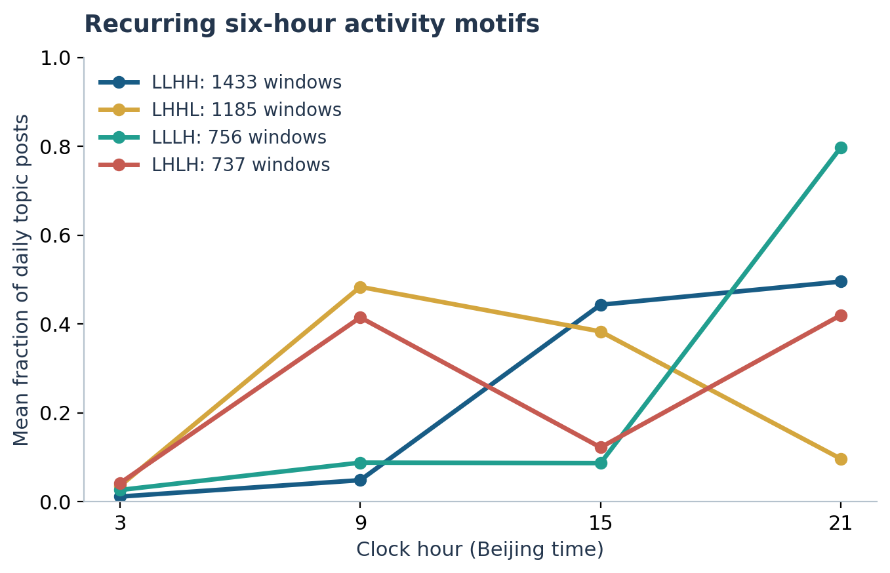

**图 05　LLHH 是最常见的时段模式，出现于 1,433 个话题日。** LLLH 的发帖集中在 18:00–23:59，该时段平均占约八成。横轴的 3、9、15、21 点是四个六小时段的中点。纵轴是同一模式下，各话题日在该时段发帖份额的平均值。图例的 `windows` 是对应模式的话题日数。 [矢量图（PDF）](figures/experiments/05_temporal_motifs.pdf)

进一步比较低 HMI（至第 25 百分位，阈值约 0.413）和高 HMI（从第 75 百分位起，阈值约 0.589）。另一项比较把话题日按第 7 节的规则分为热点日和其他活跃日。每组先为各话题计算自己出现某模式的比例，再将每个话题的比例取平均。这样一个经历很多活跃日的话题不会占据过高权重。热点与其他活跃日两组可以包含同一话题的不同日期。

| 分组 | 有可用时段模式的话题数 | 话题日数 | LLHH | LHHL | LLLH | LHLH |
| --- | ---: | ---: | ---: | ---: | ---: | ---: |
| 低 HMI | 319 | 2,277 | 26.49% | 20.09% | 14.88% | 8.81% |
| 高 HMI | 356 | 777 | 22.42% | 39.47% | 11.30% | 6.06% |
| 其他活跃日 | 783 | 3,053 | 16.21% | 18.26% | 8.80% | 10.83% |
| 热点日 | 1,173 | 2,709 | 30.46% | 30.45% | 16.21% | 5.04% |

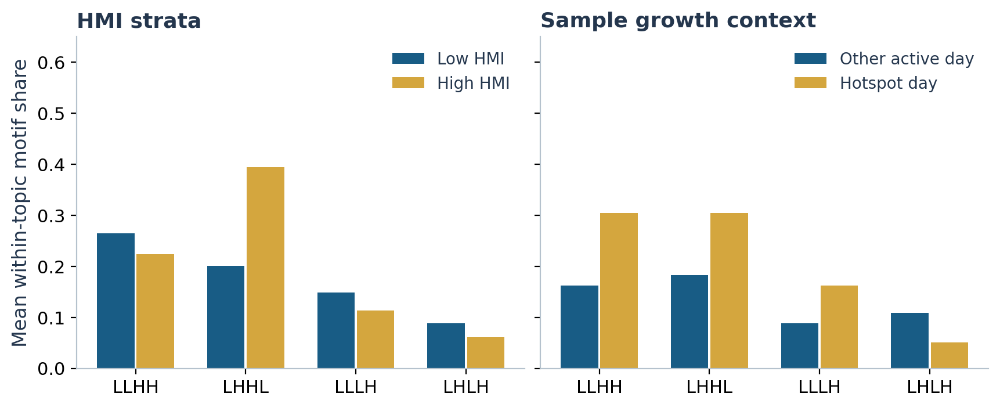

**图 13　LHHL 在高 HMI 组比低 HMI 组更常见（39.47% 对 20.09%），LLHH 在热点日比其他活跃日更常见（30.46% 对 16.21%）。** 横轴是四个最常见的时段模式。纵轴先计算每个话题的模式比例，再对组内话题取平均。左图蓝色为低 HMI、黄色为高 HMI。右图蓝色为其他活跃日、黄色为热点日。 [矢量图（PDF）](figures/experiments/13_hmi_context_patterns.pdf) · [全模式对照](results/experiments/contextual_motif_comparison.csv)

## 7. 热点案例与根帖检查

**热点日**就是某个话题在这份微博样本里明显升温的一天。程序同时看三件事：

1. 这个话题当天至少有 **4 条微博**，来自至少 **3 位不同作者**。
2. 这个话题当天占全部样本微博的比例，至少是它在**前 7 天**所占比例的 **2 倍**。例如，前 7 天占 1%，当天占 2.5%，就是 2.5 倍。
3. 前 7 天的样本日期完整，且这 7 天合计至少有 **20 条样本微博**。

计算当天和前 7 天的占比时，话题帖数和对应的样本总帖数都各加 1。这样，某个话题前 7 天一帖也没有时，程序仍能计算增长倍数。

全期 **20,756 个有发帖的话题日**中，识别出 **2,709 个热点话题日，来自 1,173 个话题**。从 HMI 排名两端各选三个不同的话题。对每个话题优先展示发帖量最多的热点日。没有符合条件的热点日时展示发帖量最多的一天，同量时取更早的一天。案例编号中的 Low 和 High 分别表示低、高 HMI，数字为组内序号。 [热点日表（匿名话题编号）](results/experiments/hotspot_windows.csv) · [六个案例的统计](results/experiments/hotspot_cases.json) · [案例发帖量曲线](figures/experiments/11_hotspot_growth.pdf)

| 图中案例 | 选中日期 | HMI | 当天帖子／作者 | 当天份额是参照的多少倍 | 样本内观察 |
| --- | --- | ---: | ---: | ---: | --- |
| Low HMI 1 | 09-30 | 0.118 | 7／7 | 4.70 | 达热点门槛。全期同分钟占比为 0，峰值日只占约 4.4%。 |
| Low HMI 2 | 09-27 | 0.120 | 7／7 | 12.96 | 达热点门槛。全期文本重复比例约 3.2%。 |
| Low HMI 3 | 10-11 | 0.125 | 8／8 | 3.29 | 达热点门槛。峰值日占全期约 2.9%。 |
| High HMI 1 | 09-30 | 0.839 | 29／29 | 246.92 | 达热点门槛。峰值日占全期约 96.7%，仍有 29 位不同作者。 |
| High HMI 2 | 09-04 | 0.838 | 31／31 | 历史不足 | 样本起点距该日不足七天，无法用本规则判定当天是否为热点。该天占该话题样本发帖的 100%。 |
| High HMI 3 | 11-30 | 0.831 | 39／39 | 313.95 | 达热点门槛。全期重复比例约 69.2%，选中日期为数据最后一天。 |

这些量可以帮助人工核对具体背景，例如查同一天是否有新闻、活动或集中转发。表中给的是样本里可以复查的现象，具体机制仍待逐案人工核对。增长倍数大的两个高 HMI 案例都应同时报告实际帖数。

**根帖可观察范围。** 程序用 `origin_weibo` 查该帖子引用的根帖是否也在样本中。209,524 条非空引用里，604 条可匹配（**0.29%**）。该字段给出根帖引用，样本缺少逐跳父帖信息，因此只报告根帖覆盖情况。 [根帖统计](results/experiments/observed_root_references.json)


## 8. 次日热点预测

### 8.1 每一行代表什么，实际答案是什么？

每一行是一对「话题、预测发起日」。用 `d` 表示预测发起日，`d+1` 表示次日。例如在 10 月 26 日结束时给话题打分，答案来自 10 月 27 日。**预测目标**是次日是否达到第 7 节的热点条件，达到记 1，其他记 0。 [构建样本代码](src/forecast_experiment.py#L27)

下表摘取 2020 年 10 月 26 日的两条实际测试记录，话题名用甲、乙代替，仅展示部分字段。两条记录都在 **10 月 26 日结束时预测 10 月 27 日**。

| 话题 | 预测发起日 | 当天帖数 | 最近 7 天帖数（含当天） | 次日实际帖数 | 次日实际作者数 | 次日实际增长倍数 | 次日是否为热点 |
| --- | --- | ---: | ---: | ---: | ---: | ---: | --- |
| 甲 | 10 月 26 日 | 2 | 4 | 4 | 4 | 8.03 | 是（1） |
| 乙 | 10 月 26 日 | 2 | 9 | 2 | 2 | 2.41 | 否（0） |

预测时能看到当天和最近 7 天的帖数。次日的实际帖数、作者数和增长要等 10 月 27 日结束后才能知道，用来核对预测结果。乙虽然增长超过 2 倍，但实际只有 2 帖、2 位作者，仍未达到热点条件。

到了第 `d` 日结束，程序只把满足下表条件的话题列进候选清单。

| 候选的条件 | 看哪一段数据 |
| --- | --- |
| 累计有至少 5 帖、3 位不同作者 | 从数据起点到第 `d` 日结束。 |
| 最近七天至少出现 1 帖 | 包括第 `d` 日的连续七天。 |
| 最近七天整个样本至少有 20 帖 | 与上一行是同一时间段，避免用过小的参照。 |

次日也可能出现从未见过、或历史很少的热点。程序另数一次次日符合条件的所有话题，作为候选覆盖率和全样本召回率的分母。这个集合跟第 7 节的 30 帖话题筛选范围不同，两处热点总量应各按自己的样本口径读。

### 8.2 预测用的数值和对照组

在每个预测日结束时，程序为每个候选话题计算三类输入。各档使用同一批候选话题和同一个次日热点定义。

1. **发帖活跃度（10 列）。** 统计当天及最近 3、7、28 天的帖数、最近 7 天的不同作者数、话题出现了多久、距上次发帖几天、最近 7 天中有几天发过帖、当天占样本帖子的比例，以及这个比例相对前 7 天的增长。帖数、作者数、话题年龄和增长倍数用 `log(1 + 数值)` 缩小极端值的影响，`log` 表示自然对数。
2. **HMI 相关指标（5 列）。** 用截至当天的最近 28 天微博，计算文本重复比例、作者发帖集中度、发帖最多那天的占比和同分钟发帖占比。再把这四个数分别放到当天候选话题中排序，平均四个百分位，得到第 5 列 HMI。观察期开头用已积累的天数。
3. **聚类组别（7 列）。** 按第 3 节的 57 维文字和行为特征给每条「话题 + 日期」记录分组。每条记录只汇总该话题截至当天的最近 28 天微博。文字先去掉标签，提取相邻 2 或 3 个字符，用 TF–IDF 加权后用截断 SVD 压成 **16 维**。行为由 **7 项摘要指标**（重复、作者集中、峰值日、同分钟、夜间、转发标记和小时分布均匀度）、**24 个小时份额**、以及**从窗口内首帖到末帖等分为十段的发帖份额**组成，共 **41 维**。将两部分按第 3 节的方法等权拼接，用 KMeans 分为 **7 组**。文字转换、行为标准化和分组中心都在训练期拟合。预测时，属于第几组就把对应的一列写为 1，其余六列写为 0。

四档都用相同设置的随机森林，以发帖活跃度为共同基线。本轮预测输入只包括下表三类特征。

| 原编号 | 随机森林输入 | 列数 | 对照目的 |
| ---: | --- | ---: | --- |
| 1 | 仅发帖活跃度 | 10 | 共同基线。 |
| 4 | 发帖活跃度 + HMI | 15 | 与组 1 比较，衡量增加 HMI 的作用。 |
| 5 | 发帖活跃度 + 七组聚类组别 | 17 | 与组 1 比较，衡量增加组别的作用。 |
| 7 | 发帖活跃度 + HMI + 七组聚类组别 | 22 | 与组 4 比较，衡量已有 HMI 时增加组别的作用。 |

聚类的行为特征和 HMI 有部分重叠，因此组 7 与组 5 的差值衡量的是**直接加入这 5 列 HMI 指标**的额外作用。

### 8.3 训练和验证日期

四档新模型用相同的训练日期学习，用相同的验证日期比较。下表中的日期是发起预测的日期，真实标签在再后一日。10 月 26 日以后的正式测试成绩是原方案的历史记录。

| 阶段 | 2020 年的预测发起日 | 候选话题日数 | 候选中的实际热点数 |
| --- | --- | ---: | ---: |
| 训练 | 09-08 至 10-09 | 36,617 | 1,051 |
| 验证 | 10-11 至 10-24 | 18,947 | 309 |
| 原方案正式测试 | 10-26 至 11-29 | 45,547 | 763 |

10-10 和 10-25 是两个隔离日。它们可以作为此前最后一个预测日的次日答案，跳过这两个预测发起日后，前一段用到的答案早于后一段的发起时间。最后一个预测日 11-29 对应的实际标签来自 11-30。

四档沿用相同设置的随机森林，每个模型含 250 棵决策树，树的末端至少有 15 条训练记录，随机种子为 28。验证使用平均精确率（AP，衡量真实热点是否排在前面）和每天前五名的命中情况。 [时间配置](configs/forecast.json) · [复跑入口](src/forecast_fused_cluster_ablation.py)

### 8.4 方案 1　七组文字与行为聚类

验证期为 **2020 年 10 月 11–24 日**。程序比较同一批 **18,947 条候选话题日**，其中 309 条实际成为热点。样本内共有 1,099 个热点话题日，候选覆盖率为 **309 ÷ 1,099 = 28.12%**。每天取分数最高的五个话题，14 天共推荐 70 次。前五精确率用命中数除以 70，候选内召回率用命中数除以 309，全样本召回率用命中数除以 1,099。 [完整指标](results/experiments/forecast_cluster7_validation_metrics.csv) · [复算记录](results/experiments/forecast_cluster7_validation.json)

| 组别 | 输入 | 验证 AP | 相对基线的 AP 增量 | 前五命中数 | 前五精确率 | 候选内召回率 | 全样本召回率 |
| ---: | --- | ---: | ---: | ---: | ---: | ---: | ---: |
| 1 | 活跃度 | 0.1722 | 0.0000 | 21 | 30.00% | 6.80% | 1.91% |
| 4 | 活跃度 + HMI | 0.1754 | +0.0032 | 18 | 25.71% | 5.83% | 1.64% |
| 5 | 活跃度 + 七组聚类组别 | 0.1778 | +0.0056 | 17 | 24.29% | 5.50% | 1.55% |
| 7 | 活跃度 + HMI + 七组聚类组别 | **0.1914** | **+0.0192** | 21 | 30.00% | 6.80% | 1.91% |

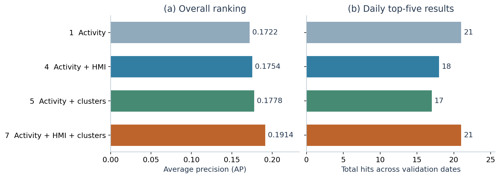

**图 23　完整模型的整体排序得分最高，每天前五名的总命中数与活跃度基线同为 21。** 左图横轴为 AP，右图横轴为 14 天的前五名总命中数。两图纵轴都对应表中的四个方案。 [PDF](figures/experiments/23_forecast_cluster7_ablation.pdf)

**加入七组聚类的作用。** 在已有活跃度和 HMI 时，加入组别使整个验证期的 AP 增加 **0.0160**，前五名命中从 **18 增到 21**。这个增益主要来自 10 月 11–17 日，该周 AP 增加 **0.0331**，命中从 7 增到 13。10 月 18–24 日，AP 下降 **0.0116**，命中从 11 降到 8。因此，七组聚类改善了这 14 天合并后的整体排序，逐周收益仍不稳定。本轮结果来自验证期。 [逐周结果](results/experiments/forecast_cluster7_validation_weeks.csv)

### 8.5 方案 2　时段模式与六组活动聚类

方案 2 在每个预测日结束时为每个候选话题计算四类输入，完整模型共 **26 列**。**发帖活跃度（10 列）**统计近 1、3、7、28 天帖数、近 7 天不同作者数、话题年龄、距上次发帖的天数、近 7 天有帖的天数、当天的发帖份额及其相对前 7 天的增长。帖数、作者数、话题年龄和增长倍数沿用第 8.2 节的对数变换。**HMI（5 列）**从近 28 天微博计算文本重复、作者集中、单日峰值和同分钟发帖四项指标，再把四项在当天候选话题中的百分位取平均，得到 HMI 总分。**时段模式（5 列）**先把每个至少有 4 帖的话题日分成四个六小时时段。帖数高于该日四个时段中位数的时段记为 H，其余记为 L，从早到晚拼成一个模式。训练期选出最常见的 LLHH、LHHL、LLLH、LHLH 四种模式。预测时，分别计算这四种模式占近 28 天可计算模式的天数的比例，再加入可计算的天数。窗口内没有可计算日期时，四种比例都记为 0。**聚类组别（6 列）**用训练期的 10 列活跃度和 5 列 HMI 指标做标准化，再用 KMeans 学出六组。验证和测试沿用这些分组中心，把所属组对应的列填 1，其余列填 0。

逻辑回归与随机森林分别比较仅活跃度、活跃度加 HMI，以及使用全部 26 列的三档输入。另有两个直接排序对照，分别按当天帖数和当天增长排序。下表保留方案 2 已完成的验证和正式测试成绩。与第 8.4 节的方案 1 比较时，应看同一验证期的成绩。 [输入与训练代码](src/forecast_experiment.py#L143)

| 对照 | 验证 AP | 测试 AP | 测试 ROC AUC | 前五名命中数 | 前五名精确率 | 候选内召回率 | 全样本召回率 |
| --- | ---: | ---: | ---: | ---: | ---: | ---: | ---: |
| 当天发帖量 | 0.1215 | 0.1119 | 0.8086 | 31 | 17.71% | 4.06% | 1.25% |
| 当天增长 | 0.1349 | 0.1035 | 0.6699 | 41 | 23.43% | 5.37% | 1.65% |
| LR，仅活跃度 | 0.1312 | 0.1289 | 0.8361 | 34 | 19.43% | 4.46% | 1.37% |
| LR，活跃度 + HMI | 0.1496 | 0.1378 | 0.8624 | 37 | 21.14% | 4.85% | 1.49% |
| LR，活跃度 + HMI + 时段模式／聚类 | 0.1386 | 0.1388 | 0.8723 | 12 | 6.86% | 1.57% | 0.48% |
| RF，仅活跃度 | 0.1722 | 0.1476 | 0.8501 | 44 | 25.14% | 5.77% | 1.77% |
| RF，活跃度 + HMI | 0.1754 | 0.1489 | 0.8685 | 42 | 24.00% | 5.50% | 1.69% |
| **RF，活跃度 + HMI + 时段模式／聚类** | **0.2802** | **0.2369** | 0.8669 | **84** | **48.00%** | **11.01%** | **3.38%** |

完整随机森林在测试中比仅活跃度随机森林多命中 **40 个**热点话题日。以完整模型为例，前五名精确率为 **84/175**，候选内召回率为 **84/763**，全样本召回率为 **84/2,485**。候选只覆盖了样本中 **763/2,485 = 30.70%** 的实际热点，解释了两个召回率为何相差较大。逻辑回归的完整档 AP 略有增加，但前五名命中数下降，说明总体排序指标和每天只取五个的表现需要同时看。 [全部指标](results/experiments/forecast_metrics.csv) · [汇总与候选覆盖](results/experiments/forecast_summary.json)

#### 原方案的逐周增益

以下 AP 差值均在同一批测试话题日上计算，正数表示加了相应输入后排序更好。

| 随机森林对照 | AP 增量 |
| --- | ---: |
| 活跃度 + HMI 相对仅活跃度 | +0.0013 |
| 再加入时段模式／聚类相对活跃度 + HMI | +0.0880 |
| 完整模型相对仅活跃度 | **+0.0893** |

计算最后一行的区间时，以星期一开头的一整周为一个单位。程序每次有放回地抽取五周，即同一周可能被抽到多次。两套模型都在同一批抽中的周上复算 AP 和差值，重复 400 次。差值从低到高的第 2.5% 和第 97.5% 位置给出 **95% 周分块估计区间 [0.0604, 0.1204]**。整周抽取保留了周内活动的相关性。测试期只有五周，区间主要描述这五周里观察到的变动。

| 测试周首日 | 候选话题日 | 实际热点 | 完整 RF 相对仅活跃度 RF 的 AP 增量 |
| --- | ---: | ---: | ---: |
| 10-26 | 8,462 | 147 | +0.0962 |
| 11-02 | 8,263 | 116 | +0.0522 |
| 11-09 | 9,035 | 156 | +0.0580 |
| 11-16 | 9,462 | 201 | +0.0817 |
| 11-23 | 10,325 | 143 | +0.1490 |

五周的完整模型差值均为正，增益大小各周不同。现有实验把时段模式和聚类一起加进模型，证据支持这一组输入在**这份样本、这个日期范围、现有候选规则下**有增益。单看 HMI 的提升较小，且个别周为负。两个新增特征各自贡献多少，需要进一步分别关闭它们才能估计。 [逐周完整差值](results/experiments/forecast_weekly_ap_deltas.csv)

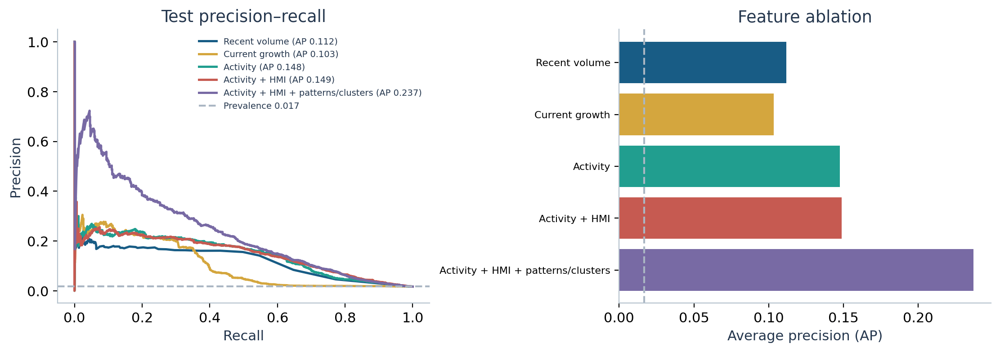

**图 14　正式测试中，完整随机森林的 AP 为 0.237，高于仅用活跃度的 0.148，优势在较低召回率区间尤其明显。** 左图横轴是找回的候选内热点占比，纵轴是入选话题中真实热点的占比。每条曲线由不同分数门槛得到。右图用 AP 概括整体排序表现，灰虚线约 0.017，表示测试候选本身的热点比例。图中包含两个简单对照和三档随机森林，逻辑回归与每日前五名的指标见第 8.5 节结果表。 [PDF](figures/experiments/14_nextday_prediction.pdf)

## 9. 重跑命令与产物位置

从仓库根目录打开 PowerShell，`.venv` 是本地 Python 3.12 虚拟环境。命令用 `-X utf8` 启用 UTF-8（统一字符编码）。Git 是版本管理工具，`--held-out` 表示评分正式留出集。重建环境时按 [项目说明文件](README.md#环境与运行) 安装依赖。本次运行使用 CPU（中央处理器）。

```powershell
$env:OPENBLAS_NUM_THREADS = '2'
$env:OMP_NUM_THREADS = '2'
.\.venv\Scripts\python.exe --version
git check-ignore -v -- data/processed/weibo.csv data/weibo_manifest.json
.\.venv\Scripts\python.exe -X utf8 src/run_experiments.py describe
.\.venv\Scripts\python.exe -X utf8 src/run_experiments.py forecast
.\.venv\Scripts\python.exe -X utf8 src/run_experiments.py forecast --held-out
.\.venv\Scripts\python.exe -X utf8 src/forecast_fused_cluster_ablation.py
```

`describe` 生成描述性结果、图 15 和复算记录。`forecast` 只到验证期。`forecast --held-out` 生成正式测试指标、图 14、按周估计区间和验证记录。两种预测模式读取同一份日期配置。 [日期配置](configs/forecast.json)

在 `describe` 完成后运行以下命令，读取仓库根目录的私有 MisBot 压缩包。压缩包在其他位置时，可在脚本名后添加带引号的路径。脚本直接读取交接分数，复算、对齐后重跑消融。`OPENBLAS_NUM_THREADS` 和 `OMP_NUM_THREADS` 分别把数值计算库和并行运行库的线程数限制为 2。 [MisBot 实验入口](src/misbot_handoff_experiment.py) · [交接职责](docs/TEAM_TASKS.md#xiaofeng-li让辅助信号可追溯)

```powershell
git check-ignore -v -- misbot_weibo_2020-09_11_570a297f_private.tar.gz
.\.venv\Scripts\python.exe -X utf8 src/misbot_handoff_experiment.py
.\.venv\Scripts\python.exe -X utf8 src/misbot_author_influence.py
```

| 运行方式 | `.local/experiments/standalone/` 下的子目录 | 本次状态与复算记录 |
| --- | --- | --- |
| `describe` | `descriptive` | [描述性检查，22 项](results/experiments/descriptive_validation.json) · [回顾性检查，35 项](results/experiments/retrospective_validation.json) |
| `misbot_handoff_experiment.py` | `misbot-handoff` | [交接复算记录](results/experiments/misbot_handoff_validation.json) |
| `misbot_author_influence.py` | `misbot-author-influence` | [高频作者影响检查](results/experiments/author_influence_validation.json) |
| `forecast` | `forecast-development` | [方案 2 验证期检查，29 项](results/experiments/forecast_development_validation.json) |
| `forecast --held-out` | `forecast` | [方案 2 测试期检查，38 项](results/experiments/forecast_test_validation.json) |
| `forecast_fused_cluster_ablation.py` | `forecast-fused-cluster7` | [方案 1 验证期复算记录](results/experiments/forecast_cluster7_validation.json) |

每个运行目录的 `results/` 保存结果表和复算记录，`figures/` 保存图片。本报告的图表随仓库提供。案例表使用匿名话题编号。原始数据、逐话题预测、案例的原始标签和模型留在 Git 忽略的路径。 [独立实验入口](src/run_experiments.py) · [分工验收与核心图](docs/reviews/experiments.md)


## 10. 补充实验

保留第 3 至 8 节的原结果。新增预测对照使用同一份微博数据。候选门槛只按验证期选择。原测试期已经用于前一次实验，本节测试结果属于同一批日期上的补充复核。

### 10.1 聚类和 HMI

**调整文字维数和权重。** 固定分为七组，比较 16、32、64 个文字维度，以及文字权重 0.25、0.50、0.75。行为权重为 1 减文字权重。文字从 16 维增到 64 维后，保留的数值变化从 **25.13% 增至 40.23%**。在文字权重 0.50 时，32 维、64 维的分组与原 16 维分组的 ARI 分别为 **0.501、0.493**。九档中原方案在固定参考空间的轮廓系数仍最高。参考空间由原方案的特征建立，另做了标题盲评。 [九档结果](results/experiments/cluster_sensitivity.csv)

**重做整个特征流程。** 六次各抽取 80% 的话题。同一次抽样分别沿用原特征、重新计算文字特征并重新标准化行为特征，再与原分组比较。两种做法的平均 ARI 分别为 **0.725、0.751**，最低分别为 **0.575、0.548**。 [六次复算](results/experiments/cluster_end_to_end.csv)

**隐藏组别后看标题。** 从 12 个话题各取一对同组和一对跨组比较，尽量匹配原文字向量的相似度。人工智能（AI）审阅者只看打乱顺序的标题与题号，先判断是否指向同一具体事件、作品或议题，再揭晓分组。同组有 **4/12** 对明确相关、4 对不确定，跨组有 **1/12** 对明确相关、6 对不确定。这是一次小样本的标题初筛。 [盲评汇总](results/experiments/cluster_review_summary.json)

**去掉重复输入后重做 HMI 对照。** 先从行为基线移除 HMI 的四项原始指标。七组方案在同一参考空间比较，主对照如下。另逐项去掉 HMI 的一个组成指标，四档轮廓系数在 **0.1171 至 0.1302**。 [全部对照](results/experiments/hmi_components.csv)

| 在删去四项原始指标的基线上加入 | 轮廓系数 | 与原分组的 ARI |
| --- | ---: | ---: |
| 无 | 0.1503 | 0.5675 |
| 四项原始指标 | 0.1475 | 0.5915 |
| HMI 总分 | 0.1251 | 0.4149 |

### 10.2 标签共现和时段模式

**标签共现。** 每个支持度和算法组合计时五次，并交替运行顺序。每档找到的项集保持一致。在 0.3% 支持度下，Apriori 和 FP-growth 的耗时中位数分别为 **0.162 秒**和 **0.617 秒**。沿用第 5 节的规则门槛，26 条原规则中，正文去重后保留 **13 条**，按同帖共现的独立作者数统计后保留 **23 条**。对 12 个完整周分别复算，有 **12 条**每周均达门槛。 [计时明细](results/experiments/itemset_repeated_runtime.csv) · [规则复算](results/experiments/association_rule_sensitivity.csv)

**时段模式。** 只比较前七天观察完整的话题日。对每个同时有两类日期的话题，计算热点日与其他活跃日的模式比例差，再对话题等权平均。表中的百分点是两个百分比直接相减。连续时段份额也用同样方式比较。 [同话题配对结果](results/experiments/matched_topic_motifs.csv) · [高低 HMI 门槛复算](results/experiments/motif_threshold_sensitivity.csv)

| 每日最低帖数 | 两类日期都有的话题数 | 热点日的 LLHH 增量 | 热点日的 LHHL 增量 | 热点日 18:00–23:59 发帖份额增量 |
| --- | ---: | ---: | ---: | ---: |
| 4 | 554 | +28.08 个百分点 | +8.94 个百分点 | +19.86 个百分点 |
| 6 | 392 | +28.56 个百分点 | +9.83 个百分点 | +18.57 个百分点 |
| 8 | 278 | +33.08 个百分点 | +11.42 个百分点 | +18.25 个百分点 |

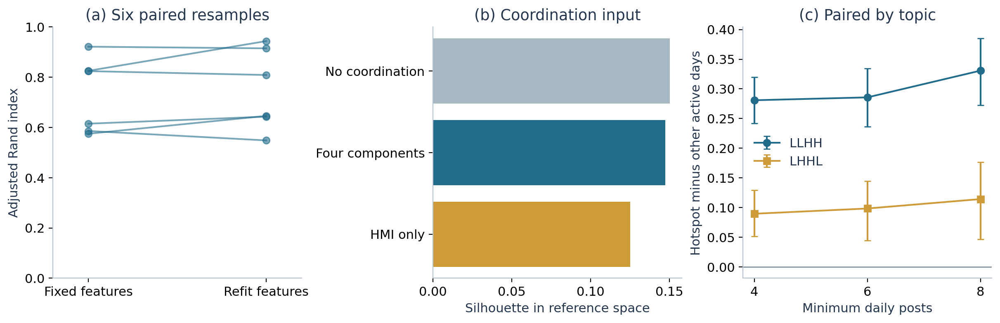

**图 16　重新提取特征后，分组稳定性仍随抽样变化。中图三档中只加 HMI 总分的轮廓系数最低。两个时段模式在三个门槛下都更常出现在同一话题的热点日。** 左图每条线对应一次配对抽样，纵轴为 ARI。中图横轴为同一参考空间的轮廓系数。右图横轴为每日最低帖数，纵轴为热点日减去其他活跃日的模式比例，竖线为按话题重新抽样得到的 95% 估计区间。 [矢量图（PDF）](figures/experiments/16_mining_extensions.pdf)

### 10.3 配对案例与根帖覆盖

重新配三对高低 HMI 话题。每对来自同一聚类，优先匹配全期帖数、活跃天数和文字相似度。只选前后七天均有覆盖的热点日。下表的重复和转发比例均指热点当天，斜杠左边为低 HMI，右边为高 HMI。 [案例结果](results/experiments/matched_case_aggregates.csv)

| 配对 | 全期帖数／活跃天数（低组与高组） | 重复文本比例（低／高） | 正文转发标记比例（低／高） | 可查到的同期公开事件 |
| --- | --- | --- | --- | --- |
| 1 | 低组 40 帖、5 天，高组 40 帖、5 天 | 0%／17.1% | 32.4%／45.7% | 低组对应 10 月 3 日美国总统医生简报，高组对应 10 月 30 日新加坡开放入境申请。 [医生简报实录](https://rollcall.com/factbase/trump/transcript/donald-trump-sean-conley-physician-press-conference-walter-reed-october-3-2020/) · [新加坡民航局公告](https://www.caas.gov.sg/resources/media-and-publication/newsroom/singapore-welcomes-visitors-from-mainland-china-and-victoria-state-australia-fro/) |
| 2 | 低组 38 帖、4 天，高组 37 帖、4 天 | 6.3%／50.0% | 12.5%／87.5% | 低组对应 9 月 27 日江西发布的病例消息，高组对应 10 月 16 日青岛发布会。 [《江西日报》同期报道](https://epaper.jxxw.com.cn/resfile/2020-09-28/02/02.pdf) · [国家卫健委转载的青岛发布会报道](https://en.nhc.gov.cn/2020-10/19/c_81905.htm) |
| 3 | 低组 43 帖、3 天，高组 39 帖、3 天 | 2.9%／36.7% | 50.0%／40.0% | 两个话题均对应 9 月 8 日全国抗疫表彰大会。 [大会报道](https://www.cac.gov.cn/2020-09/08/c_1601123952659681.htm) |

三对案例的发帖峰值都集中在事件日。高 HMI 话题的文本重复比例均较高，正文转发标记比例并非每对都更高。集中报道或共用措辞是可能解释。公开记录能核对事件日期，帖子中的行为指标只反映样本中的发帖方式。

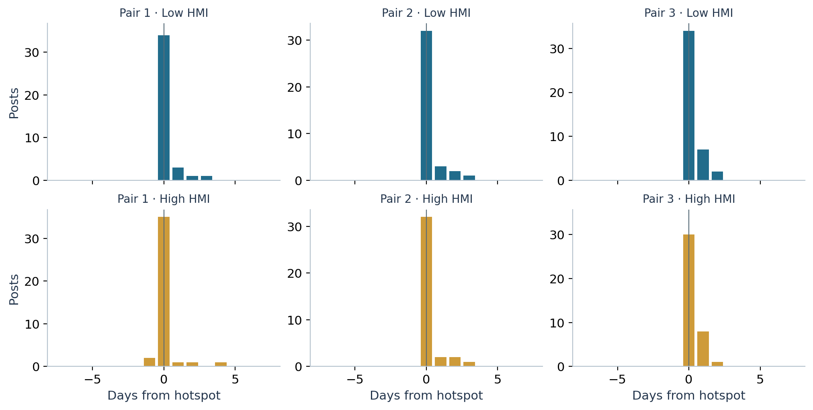

**图 18　匹配话题规模和活跃天数后，高低 HMI 案例都出现了单日发帖峰值。** 每列是一对，上排蓝色为低 HMI，下排黄色为高 HMI。横轴 0 是热点日，横纵轴分别为相对日期和每日样本帖数。同一列共用纵轴。 [矢量图（PDF）](figures/experiments/18_matched_cases.pdf)

**根帖样本差异。** 匹配到根帖的 604 条微博中，**56.3%** 带标签，**16.9%** 的规范正文在有根帖引用的样本中重复。未匹配的 208,920 条分别为 **68.9%** 和 **32.2%**。可匹配记录的组成不同。原始月表的 13.12% 匹配率来自数据交接审计，本轮新增比较在本地子集完成。 [按月结果](results/experiments/reference_match_comparison.csv) · [数据交接审计](docs/reviews/weibo_cov_handoff.md)

### 10.4 预测输入拆分与候选门槛

**拆开新增输入。** 固定原候选、日期和随机森林参数。下表中的加号表示在「活跃度加 HMI」之上加入该输入。AP 和每天前五名命中数均来自原测试期。 [全部消融](results/experiments/feature_ablation.csv)

| 输入 | AP | 前五名命中数 |
| --- | ---: | ---: |
| 仅活跃度 | 0.1476 | 44 |
| 活跃度加 HMI | 0.1489 | 42 |
| + 时段模式比例 | 0.2352 | 84 |
| + 可计算时段模式的天数 | 0.1509 | 46 |
| + 聚类编号 | 0.1505 | 44 |
| + 时段模式比例与天数 | 0.2372 | 85 |
| + 时段模式比例与聚类编号 | 0.2337 | 83 |
| + 天数与聚类编号 | 0.1500 | 46 |
| + 三类输入 | 0.2369 | 84 |

只加时段模式比例就能找回原完整模型的大部分 AP 增量，命中数相同。单加天数或聚类编号的增量较小。「模式加天数」在原测试期只多命中一次，表格用于复核贡献，原方案仍作为正式基线。

**候选门槛。** 记号「最低累计帖数／最低累计作者数／最近活跃天数」表示三个共同条件。最后一个条件要求该窗口至少有一条话题微博。验证期先选每日前五名总命中数最高的规则，并列时选覆盖率更高的一档，再并列时选候选数更少的一档。 [验证期门槛表](results/experiments/candidate_validation.csv)

| 规则 | 验证期候选数 | 热点覆盖率 | 前五名命中数 |
| --- | ---: | ---: | ---: |
| 5／3／7（原规则） | 18,947 | 28.12% | 38 |
| 3／2／7（验证期选中） | 26,044 | 33.03% | 40 |
| 2／2／7 | 33,137 | 36.03% | 37 |
| 5／3／14 | 27,976 | 29.39% | 40 |
| 3／2／14 | 40,478 | 34.67% | 34 |

只有原规则和验证期选中的规则进入测试期对照。候选数从 45,547 增到 61,950，覆盖率从 **30.70% 升到 33.96%**，命中从 **84 升到 85**。AP 从 **0.2369 降到 0.2238**，两个值分别按各自的候选清单计算。首次在次日出现的话题仍需要另一种候选来源。 [测试期门槛对照](results/experiments/candidate_test.csv)

**按时间复核。** 用测试期之前连续四个七天窗口，每次只用更早的数据重训，留出一天隔离。完整模型比仅活跃度模型的 AP 增量依次为 **0.0532、0.0926、0.1340、0.0761**。在原测试期每次去掉一周后复算，增量仍在 **0.0727 至 0.0976**。这些窗口来自同一语料期，适用范围仍是当前样本。 [滚动验证](results/experiments/rolling_validation.csv) · [逐次去掉一周](results/experiments/leave_one_week_out.csv)

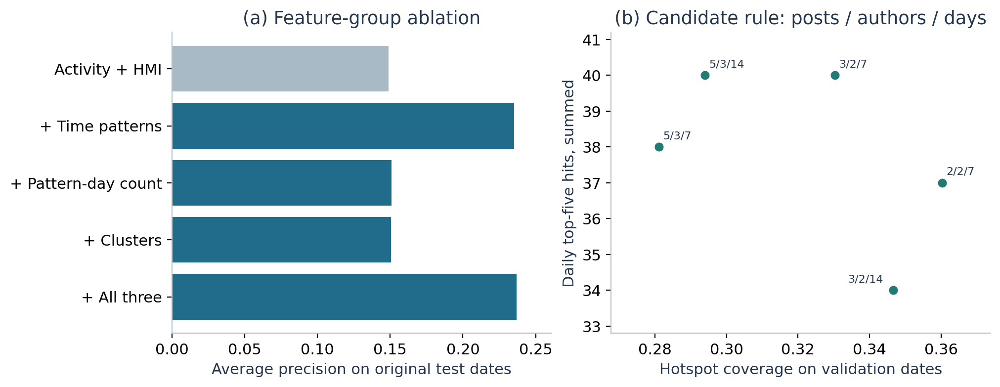

**图 17　时段模式承担了主要的排序增益。验证期覆盖率最高的候选规则，前五名命中数低于选中的规则。** 左图横轴是原测试期 AP，纵轴是各输入组合。右图横轴是验证期热点覆盖率，纵轴是所有日期前五名命中总数，点旁三个数字表示帖数、作者数和最近活跃天数。 [矢量图（PDF）](figures/experiments/17_forecast_extensions.pdf)

### 10.5 补充实验复跑

先按第 9 节生成描述性和正式预测结果，再从仓库根目录运行以下命令。结果表和图写入 `.local/experiments/standalone/extensions/`。MisBot 风格分数消融的结果见第 4 节，复跑用第 9 节的独立入口。

```powershell
$env:OPENBLAS_NUM_THREADS = '2'
$env:OMP_NUM_THREADS = '2'
.\.venv\Scripts\python.exe -X utf8 src/mining_extensions.py
.\.venv\Scripts\python.exe -X utf8 src/forecast_extensions.py
```

描述性脚本生成盲评题。人工智能审阅记录及汇总保存在本地结果目录。 [描述性补充代码](src/mining_extensions.py) · [预测补充代码](src/forecast_extensions.py)
